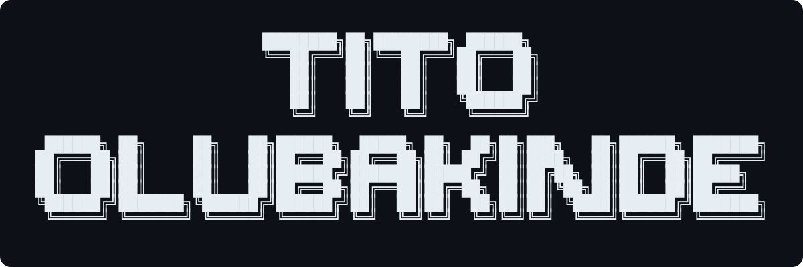

<!-- 

<pre>
████████╗██╗████████╗ ██████╗
╚══██╔══╝██║╚══██╔══╝██╔═══██╗
   ██║   ██║   ██║   ██║   ██║
   ██║   ██║   ██║   ██║   ██║
   ██║   ██║   ██║   ╚██████╔╝
   ╚═╝   ╚═╝   ╚═╝    ╚═════╝

 ██████╗ ██╗     ██╗   ██╗██████╗  █████╗ ██╗  ██╗██╗███╗   ██╗██████╗ ███████╗
██╔═══██╗██║     ██║   ██║██╔══██╗██╔══██╗██║ ██╔╝██║████╗  ██║██╔══██╗██╔════╝
██║   ██║██║     ██║   ██║██████╔╝███████║█████╔╝ ██║██╔██╗ ██║██║  ██║█████╗
██║   ██║██║     ██║   ██║██╔══██╗██╔══██║██╔═██╗ ██║██║╚██╗██║██║  ██║██╔══╝
╚██████╔╝███████╗╚██████╔╝██████╔╝██║  ██║██║  ██╗██║██║ ╚████║██████╔╝███████╗
 ╚═════╝ ╚══════╝ ╚═════╝ ╚═════╝ ╚═╝  ╚═╝╚═╝  ╚═╝╚═╝╚═╝  ╚═══╝╚═════╝ ╚══════╝
</pre> -->

  

### Software engineering · Artificial intelligence · Robotics

I like understanding how things work, building something useful,  
and making it hold up beyond the demo.

---

### About me

I'm **Tito**, a Computer Science student at the **University of Delaware**, concentrating in **AI & Robotics**.

I'm interested in how data moves through systems, how components fit together, and what happens when something fails.

Currently exploring **backend infrastructure, robotic perception, and autonomous systems**.

Outside of code: table tennis, basketball, and entrepreneurship.

### How I build

Start with a concrete problem. Build the smallest useful version. Test the assumptions. Document the decisions.

I care about readable code, reproducible results, and understanding the tradeoffs behind what I ship.

### Let's connect

Always happy to talk software, robotics, research, or an idea worth building.

[LinkedIn](https://www.linkedin.com/in/oluwatito-olubakinde/) &nbsp; 

